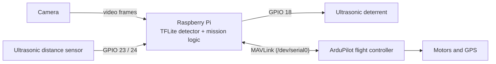
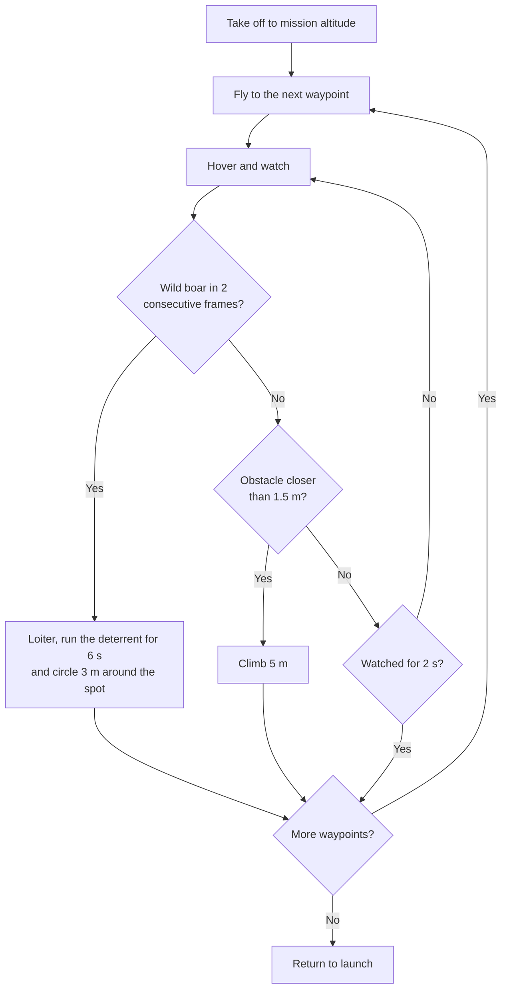

# Autonomous Drone for Wild Boar Detection and Deterrence

An autonomous drone that patrols farmland, spots wild boar with an onboard vision model, and drives them off with an ultrasonic deterrent. It protects crops without harming the animals.

## System overview



The Raspberry Pi runs two background threads the whole time: one runs the detector on the camera feed, the other reads the distance sensor. The main loop flies the mission through the flight controller using DroneKit and reacts to what the threads report.

## Mission flow



Requiring two consecutive frames keeps one-off false detections from triggering the deterrent. Any error during the mission switches the drone to Return-to-Launch.

## Hardware

| Component | Role |
|-----------|------|
| Raspberry Pi | Runs detection and the mission logic |
| ArduPilot flight controller | Flies the drone; talks to the Pi over MAVLink |
| Camera (USB or CSI) | Video feed for the detector |
| Ultrasonic distance sensor (HC-SR04 type) | Obstacle detection |
| Ultrasonic deterrent | Switched on and off by the Pi |

## Code structure

| File | Purpose |
|------|---------|
| `main.py` | Mission loop: takeoff, waypoints, reacting to detections and obstacles, failsafes |
| `detection.py` | TFLite detector running on the camera feed |
| `deterrent.py` | Switches the deterrent on and off |
| `sensors.py` | Reads the ultrasonic distance sensor |
| `camera.py`, `model.py` | Camera and model helpers |
| `mission.json` | Waypoints as `{"lat", "lon", "alt"}` |
| `setup_pi.sh` | Installs the dependencies on the Pi |

## Setup

On the Raspberry Pi:

```bash
bash setup_pi.sh
```

Put your trained model at `wild_boar_model.tflite`, add your waypoints to `mission.json`, then run:

```bash
python3 main.py --connect /dev/serial0 --mission mission.json
```

Settings such as how long to watch at each waypoint (`WAYPOINT_WAIT_S`, 2 s by default), the detection threshold, the number of confirmation frames and the GPIO pins are constants at the top of `main.py`. Set `RTL_ON_DETECTION = True` to send the drone home on the first detection instead of deterring.

## Testing without flying

Try missions in ArduPilot's simulator (SITL) before a real flight. Start SITL, then point the script at it:

```bash
python3 main.py --connect tcp:127.0.0.1:5760 --mission mission.json
```

## Team

Kevin Benty, Athul Joe Palliparambil, Alan Cherian, Aswin Anilkumar and Amal Roy, Government Engineering College, Idukki
